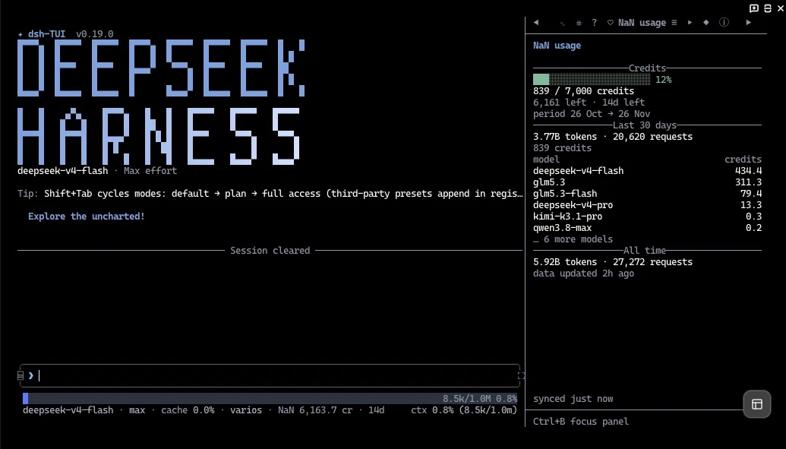

# dsh-nan-provider

Set up and watch your **NaN** ([nan.builders](https://nan.builders))
subscription inside the DeepSeek Harness TUI ([dsh-tui](https://github.com/ccch1mneyyy/dsh-TUI)): creates the provider, stores the
key, sets the default model and shows credits and spend in the sidebar. Based on
the idea of [pi-nan-provider](https://github.com/gtrabanco/pi-nan-provider).

🇬🇧 **English** · 🇪🇸 [Español](README.md)

<p align="center">
  
</p>

## What it does

- **`/nan-setup`**: creates or refreshes the `nan` provider. It asks for the key
  when missing (and stores it), fetches `{baseURL}/models`, merges it with the
  catalog —new chat models get conservative defaults; embeddings, rerank, STT,
  TTS and image models are filtered out— and sets `deepseek-v4-flash` as the
  default model. It never deletes `openai` or hand-edits the YAML: it writes
  through the settings service, exactly like `/provider`.
- **“NaN usage” sidebar tab** next to Info / Todo / Jobs (`◈` icon): billing
  period credit bar, credits left and days, last 30 days with top models, daily
  sparkline and all-time totals.
- **`/nan-usage`** opens the tab; **`/nan-usage text`** returns the report in chat.
- **Footer chip** (`NaN 6,195 cr · 14d`) on the status row, with the full
  breakdown on hover. `footer: false` turns it off.

> The built-in Info panel is host code with fixed sections; a dedicated tab is
> the supported route. The chip joins the existing status row because there is
> no seam for an extra footer line.

## Install

### TUI (`dsh-tui`)

```bash
dsh plugin --profile dsh-tui add dsh-nan-provider
```

Or from inside the TUI: `/plugin install dsh-nan-provider`.

### Desktop (DeepSeek Harness)

1. Open **Settings → Plugins → Add plugin**.
2. Type `dsh-nan-provider` and confirm.
3. Restart the app when it finishes.

The `desktop` profile is owned by the Electron app: `dsh plugin --profile
desktop` answers `profile "desktop" is managed exclusively by the Electron
application`. Always install it from Settings.

In both cases make sure you end on the latest version (`npm view
dsh-nan-provider version`): right after publishing, pin it explicitly
(`add dsh-nan-provider@latest`) so a registry cache cannot resolve an old one.

## Getting started (TUI + Desktop)

Each profile keeps its own configuration, so there is exactly one order that
works:

1. **Configure once in the TUI:** `/restart`, then `/nan-setup`.
   - Creates or refreshes the `nan` provider with the catalog models.
   - Asks for the key when missing and stores it as `NAN_API_KEY`.
   - Sets `deepseek-v4-flash` as the default model.
   - Publishes the result to **`~/.dsh/nan-provider.json`**.
2. **Check it in the TUI:** `/nan-usage` opens the `◈` tab with the credits.
3. **Open Desktop.** About 3 s after activation the plugin applies that file
   through the `desktop` profile's own settings service, so the provider shows
   up configured. It logs “NaN provider synced” and writes the route into
   `~/.dsh/profiles/desktop/cordis.patch.yml`.
4. **Check it in Desktop:** `/nan-usage` returns the text report.

How the profiles are linked:

- The key is shared: `~/.dsh/.credentials.yaml` (`NAN_API_KEY`).
- Provider and models travel through `~/.dsh/nan-provider.json`.
- A profile with an existing `nan` route and no shared file publishes it (first
  boot after upgrading). `/nan-setup` is what updates it afterwards.

Desktop has no panel or footer chip (TUI seams): `/nan-setup` and `/nan-usage`
(text report) are available.

Same on macOS, Windows and Linux: plain ESM with `fetch`, no native
dependencies. Config lives under `~/.dsh` (`%USERPROFILE%\.dsh` on Windows) and
the TUI state under `~/.dsh-tui`.

## Start from scratch (reset)

To make the harness behave like a first run without losing chat history:

```bash
./scripts/reset.sh --dry-run   # preview what it would delete
./scripts/reset.sh             # asks for confirmation, writes a backup
```

On native Windows (PowerShell):

```powershell
pwsh -File .\scripts\reset.ps1 -DryRun
pwsh -File .\scripts\reset.ps1
```

What it removes:

- `~/.dsh/.credentials.yaml` (stored keys, `NAN_API_KEY` included)
- `~/.dsh/nan-provider.json` (the shared provider)
- `cordis.patch.yml` of both `dsh-tui` and `desktop` (providers and model)
- TUI preferences: `model.json`, `model-recents.json`, `effort.json`,
  `permission.json`

What it never touches: `~/.dsh/sessions`, `~/.dsh/attachments`,
`~/.dsh/storages`, `~/.dsh-tui/history.jsonl`, `session-index.json` or
`session-lists`.

Each run writes a backup to `~/dsh-backup-<date>/`. It honours `DSH_HOME` and
`DSH_TUI_HOME` when overridden.

After a reset: install the plugin in each profile, run `/nan-setup` in the TUI
and open Desktop.

## API key

The plugin finds the provider by id `nan`, by a `nan.builders` `baseURL` or by a
“NaN” label, then uses its `apiKeyEnv` (and `baseURL`) for the `/nan-usage` call.
Without a NaN route the query fails and points at `/nan-setup`: there is no
loose key or URL fallback.
The credential ref is **`NAN_API_KEY`**, owned by this plugin, so a separate
OpenAI provider can keep `OPENAI_API_KEY` without collisions. It is resolved per
operation from the harness credential store (`~/.dsh/.credentials.yaml`) and,
failing that, from the `NAN_API_KEY` environment variable. When neither has it,
`/nan-setup` prompts for it (visible while typing) and stores it. The file is
never read directly.

The endpoint is `GET {baseURL}/usage` (documented in
`https://nan.builders/openapi.json`); it does not consume credits.

## Configuration

Optional; set it on the `nan` row of
`~/.dsh/profiles/dsh-tui/cordis.patch.yml`:

| key                    | default                       | what it does                                             |
| ---------------------- | ----------------------------- | -------------------------------------------------------- |
| `provider`             | `nan`                         | route id detected and configured                         |
| `apiKeyEnv`            | `NAN_API_KEY`                 | credential ref `/nan-setup` uses when creating the route |
| `baseUrl`              | `https://api.nan.builders/v1` | base `/nan-setup` uses when creating the route           |
| `windowDays`           | `30`                          | breakdown window (1–90)                                  |
| `autoRefreshSeconds`   | `60`                          | refresh while visible (`0` = off)                        |
| `lowCreditsPercent`    | `10`                          | `warning`/`error` badge threshold                        |
| `commandName`          | `usage`                       | usage command name                                       |
| `panelId`              | `usage`                       | internal panel id                                        |
| `panelTitle`           | `NaN usage`                   | tab title                                                |
| `footer`               | `true`                        | footer credits chip                                      |
| `footerRefreshMinutes` | `15`                          | chip refresh interval                                    |
| `cacheSeconds`         | `20`                          | shared panel/command cache                               |
| `setupModel`           | `deepseek-v4-flash`           | model `/nan-setup` selects                               |
| `setupEffort`          | `max`                         | effort `/nan-setup` selects                              |

## Development

```bash
npm install --include=dev   # NODE_ENV=production skips devDependencies otherwise
npm test                    # 49 tests; the 3 render tests use react-test-renderer
```

No runtime dependencies: only `fetch` and the harness services. The panel uses
the host’s React and `ui` kit (single-React rule) and `ui.useAnimationTime` as
its clock.

## Layout

```text
lib/index.js        panel, /nan-usage, /nan-setup and footer (cordis inject)
lib/catalog.js      canonical NaN provider profile (11 models)
lib/provider.js     nan route detection (settings)
lib/setup.js        /nan-setup: provider + key + default model
lib/shared.js       shared file and cross-profile auto-sync
lib/overrides.js    measured catalog overrides (pi-nan-provider)
lib/api.js          /usage client + defensive normalization
lib/source.js       shared cache and route/key resolution
lib/panel.js        panel React component (no JSX, host React)
lib/format.js       numbers, bars, sparkline, dates (pure)
lib/text-report.js  text report and error messages
cordis.patch.yml    row that mounts the bundle in the profile
scripts/reset.sh    config/credential reset (bash: macOS, Linux, Windows Git Bash)
scripts/reset.ps1   same for PowerShell on Windows
dsh-plugin.json     0.15 manifest (ecosystem metadata)
```

## Credits

The idea of generating the catalog from a public source and correcting it with
measured overrides — plus the non-chat endpoint filtering — comes from
[pi-nan-provider](https://github.com/gtrabanco/pi-nan-provider), MIT
(Copyright (c) 2026 gtrabanco). The values and provenance notes in
`lib/overrides.js` come from its `scripts/manual-overrides.ts`; the full license
and attribution live in [LICENSE](LICENSE) and [NOTICE](NOTICE). This project
ships under the same MIT license.

Live models the endpoint announces without metadata get pi-nan-provider's
conservative envelope: 128k context, 4k output, text only, no adjustable
reasoning. Capabilities are never invented.
