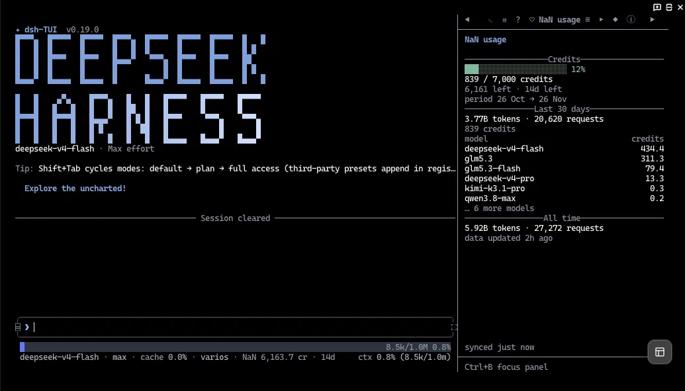

# dsh-nan

Configura y vigila tu suscripción **NaN** ([nan.builders](https://nan.builders))
dentro de la TUI de DeepSeek Harness: crea el proveedor, guarda la clave, deja
el modelo por defecto y muestra créditos y gasto en el sidebar.

🇬🇧 [English](README.en.md) · 🇪🇸 **Español**

<p align="center">
  
</p>

## Qué hace

- **`/nan-setup`**: crea el proveedor `nan` con los 11 modelos del catálogo
  (endpoint, compat, reintentos), comprueba la clave y fija
  `deepseek-v4-flash` como modelo por defecto. No borra `openai` ni edita el
  YAML a mano: escribe por el servicio de settings, igual que `/provider`.
- **Pestaña «NaN usage»** en el sidebar, junto a Info / Todo / Jobs (icono `◈`):
  barra de créditos del periodo, restante y días, últimos 30 días con top de
  modelos, sparkline diaria y total histórico.
- **`/usage`** abre la pestaña; **`/usage text`** devuelve el informe en el chat.
- **Chip en el footer** (`NaN 6,195 cr · 14d`) en la línea de estado, con el
  desglose al pasar el ratón. `footer: false` lo apaga.

> El panel Info del sidebar es código del host con secciones fijas; la vía
> soportada es una pestaña propia. El chip se une a la línea de estado existente
> porque no hay seam para una segunda línea de footer.

## Instalación

```bash
dsh plugin --profile dsh-tui add dsh-nan
```

## Puesta en marcha

1. `/nan-setup` — crea el proveedor y fija el modelo por defecto.
2. Si no había clave: `/login` (o Ajustes → Proveedores) para guardar la de NaN.
3. `/restart` para montar la ruta.
4. `/usage` (o la pestaña `◈`) para ver el consumo.

El setup es idempotente: si `nan` ya existe lo deja intacto y solo verifica la
clave y el modelo por defecto.

## Clave de API

El plugin detecta el proveedor por id `nan`, por `baseURL` de `nan.builders` o
por etiqueta «NaN», y usa su `apiKeyEnv` (y su `baseURL`) para consultar
`/usage`. Si no encuentra proveedor, cae a `OPENAI_API_KEY` y a
`https://api.nan.builders/v1`.

La clave se resuelve por operación desde el store de credenciales del harness
(`~/.dsh/.credentials.yaml`) y, si no está, desde la variable de entorno. El
fichero nunca se lee directamente.

El endpoint es `GET {baseURL}/usage` (documentado en
`https://nan.builders/openapi.json`); no consume créditos.

## Configuración

Opcional; se ajusta en la fila `nan` de
`~/.dsh/profiles/dsh-tui/cordis.patch.yml`:

| clave | por defecto | qué hace |
| --- | --- | --- |
| `provider` | `nan` | id de la ruta que se detecta y configura |
| `apiKeyEnv` | `OPENAI_API_KEY` | ref de credencial de respaldo |
| `baseUrl` | `https://api.nan.builders/v1` | base de la API de respaldo |
| `windowDays` | `30` | ventana del desglose (1–90) |
| `autoRefreshSeconds` | `60` | refresco con el panel visible (`0` lo apaga) |
| `lowCreditsPercent` | `10` | umbral del badge `warning`/`error` |
| `commandName` | `usage` | nombre del comando de consumo |
| `panelId` | `usage` | id interno del panel |
| `panelTitle` | `NaN usage` | título de la pestaña |
| `footer` | `true` | chip de créditos en el footer |
| `footerRefreshMinutes` | `15` | refresco del chip |
| `cacheSeconds` | `20` | caché compartida panel/comando |
| `setupModel` | `deepseek-v4-flash` | modelo que fija `/nan-setup` |
| `setupEffort` | `max` | effort que fija `/nan-setup` |

## Desarrollo

```bash
npm install --include=dev   # NODE_ENV=production omite devDependencies si no se lo pides
npm test                    # 30 tests; los 3 de render usan react-test-renderer
```

Sin dependencias de runtime: solo `fetch` y los servicios del harness. El panel
usa el React y el `ui` del host (regla single-React) y `ui.useAnimationTime`
como reloj.

## Estructura

```text
lib/index.js        panel, /usage, /nan-setup y footer (cordis inject)
lib/catalog.js      perfil canónico del proveedor NaN (11 modelos)
lib/provider.js     detección de la ruta nan (settings)
lib/setup.js        /nan-setup: provider + clave + modelo por defecto
lib/api.js          cliente de /usage + normalización defensiva
lib/source.js       caché compartida y resolución de la ruta/clave
lib/panel.js        componente React del panel (sin JSX, React del host)
lib/format.js       números, barras, sparkline, fechas (puro)
lib/text-report.js  informe de texto y mensajes de error
cordis.patch.yml    fila que monta el bundle en el perfil
dsh-plugin.json     manifiesto 0.15 (metadata de ecosistema)
```
